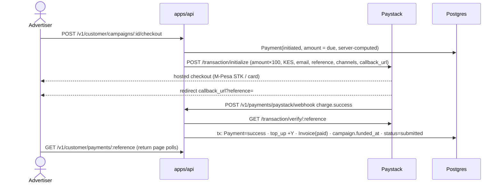

# Paystack payments: collections, refunds and driver payouts

Status: **approved decisions folded in 2026-11-08; ready for planning.** It supersedes the Pesapal decision of 2026-08-31 (see [ROADMAP.md](../../shared/ROADMAP.md), "Payments"). Owner: Victor. Plan: [2026-11-08-paystack-payments.md](../plans/2026-11-08-paystack-payments.md).

Each item is marked by who made the call: **(owner)** means Victor decided it, and **(author)** means it is a builder-level call, open to override.

## 1. Intent

Let an advertiser fund a campaign online, by M-Pesa or card, at the moment they submit it, and have every finance screen show real money. Let ops pay drivers with one Disburse press, sent to each driver's own M-Pesa or bank account.

Today booking stops exactly at payment. The customer billing screens and the ops Finances screens read real tables that only the dev demo seed fills. The driver earnings screens render `lib/placeholder-data` fixtures.

### Goals
- Pay and submit in one sitting. Ops reviews the campaign once, and payment confirmation is automatic, never a second human step **(owner)**.
- Money is held as an advertiser balance. Unused money (from a rejection, cancellation or under-delivery) stays as credit and is used first at the next checkout **(owner)**.
- The advertiser can request a refund of unused credit. It goes back to the original payment method after ops approves, and there are no free cash-outs to arbitrary numbers **(owner)**.
- Driver payouts are automated through Paystack Transfers. Ops enters each driver's amount and presses Disburse **(owner)**.
- Every money mutation is idempotent and audited.
- No finance screen shows placeholder data: the customer billing screens, the ops Finances tabs, and the driver payout and earnings screens.

### Non-goals (v1)
- A computed driver pay formula (per hour, per km, or a revenue share). Ops types the amounts **(owner)**.
- VAT. Admobi is not VAT-registered (see §10). The tax rate is 0 behind a single constant.
- KRA eTIMS invoices (see §10).
- Credit terms or net-30 invoicing. Corporates prepay by bank transfer, which ops records.
- Saved cards, subscriptions, recurring charges.
- Pesapal and PayHero. Neither is integrated (see §9).

### Anti-goals
- Crediting money twice, or crediting a different amount than we charged.
- Submitting or approving a campaign on an unverified webhook.
- Letting a leaked Paystack secret key drain the balance through transfers we didn't create (see §8.4).
- A cash refund that the books count as a spend reversal (see §4).

## 2. Money model

```
Advertiser ──M-Pesa/card──▶ Paystack balance ──Disburse──▶ Driver M-Pesa / bank
                                  │
                                  └──ops sweep──▶ Admobi bank (auto after 60 days)
```

- **Paystack settlement mode: "Manual Payouts" (owner).** Collections stay in the Paystack balance and fund driver transfers directly. Ops sweeps any surplus to the Admobi bank account. Paystack auto-settles anything left untouched for 60 days.
- **The advertiser's balance is a ledger view, not an account.** It is `SUM(wallet_transactions.amount_kes)` per org, which is already the schema's definition.
- **Committed** is the money held for funded campaigns that haven't finished yet. **Available** is balance minus committed. Both already exist in `finance-queries.ts`; only the definition of "holds funds" changes (§5.4).
- **Fees are absorbed (owner).** The advertiser is credited the gross amount paid. Paystack's fee is an Admobi cost, stored on the `Payment` row and subtracted in ops net margin.

## 3. What exists (reuse, don't rebuild)

| Piece | Where | Change |
|---|---|---|
| Ledger | `WalletTransaction`: kinds `top_up`, `spend`, `refund`, `adjustment`; signed; unique `reference` | Add kind `cash_refund`; provider `paystack` |
| Invoice | `Invoice`: per campaign, `lines` snapshot, `status`, `paid_at` | Written on each successful payment, as a receipt |
| Customer finance API | `apps/api/lib/analytics/finance-queries.ts` (balance, committed, available, runway, upcoming charges) | "Committed" uses the new `holdsFunds` |
| Customer billing UI | `apps/customer-web/components/billing/*`; Top up opens `TopUpNoticeDialog` | Real top-up and refund request |
| Ops finance | `apps/ops/lib/queries/finance.ts` (direct SQL), tabs `overview`, `ledger`, `wallets`, `payouts`, `tool-costs`; `ComingSoonDialog` for Payout/Transfer | Real Payout run and Refund actions |
| Ops manual entry | `POST /v1/ops/finance/transactions` | Stays as the bank-transfer path; gains `cash_refund` |
| Campaign lifecycle | `submit` route, `review` route; `EDITABLE_STATUSES = draft, changes_requested, rejected` | Submit requires funding |
| Pricing | `packages/ops-contracts/src/pricing.ts` estimator writes into the advertiser's `budget_kes` | Unchanged; the charge is `budget_kes` |
| Driver payout details | `DriverProfile.payout_method` (`mpesa`/`bank`), `payout_mpesa_msisdn`, `payout_bank_name`, `payout_bank_account` | Add `payout_bank_code`, `paystack_recipient_code` |
| Payouts | `Payout` → FK to `Driver`, **the marketing-leads table, not the Clerk driver** | Re-point to `DriverProfile` |
| Cron | `apps/api/vercel.json` runs one daily cron; `CRON_SECRET` bearer pattern in `push-receipts/check` | Add one daily finance cron |

## 4. Ledger kinds (the one semantic trap)

| kind | sign | meaning | counts as |
|---|---|---|---|
| `top_up` | + | Money received (Paystack, or a manual bank transfer) | money in |
| `spend` | − | Budget consumed by a flight day | revenue (unless `tax`) |
| `refund` | + | **Spend given back to the balance**, e.g. ops reverses a bad delivery day. Existing meaning, unchanged | negative revenue |
| `adjustment` | ± | Ops correction | neither |
| `cash_refund` **(new)** | − | Money returned to the payer through Paystack, or by bank | money out, **not** revenue |

Reusing `refund` for money sent back to the payer would cut revenue and inflate "spent". That's why `cash_refund` is a separate kind. Every query that filters `kind IN ('spend','refund')` stays correct untouched. The places that list kinds (`WALLET_TRANSACTION_KINDS`, labels, ops record dialog, money in/out charts) gain `cash_refund`.

## 5. Advertiser flow

### 5.1 Pay at submission (owner)

The wizard's Review step shows the budget, the available balance, and **Due now = max(0, budget − available)**.

- **Due = 0:** the button reads "Submit (KES X from your balance)". The submit endpoint funds the campaign from the balance and submits it, in one transaction holding a row lock on the org.
- **Due > 0:** the button reads "Pay KES Y and submit", and calls the checkout endpoint. On a verified payment the server credits the balance, funds the campaign and submits it, sending the same notifications as today's submit, with no second click. If the balance changed in between and no longer covers the budget, the money stays as credit, the campaign stays a draft, and the advertiser is notified.

Ops reviews exactly once, as today, and only sees campaigns that are already funded.



### 5.2 Standalone top-up
The billing "Top up" button opens an amount dialog and runs the same checkout with no campaign. That's how someone prepays a balance and how a large corporate pays by card. Bank transfers stay manual: ops records a `top_up`.

### 5.3 Confirmation, failures and reconciliation
- **Paystack sends webhooks only for successful charges.** Failure is learned by calling verify. The return page polls `GET /v1/customer/payments/:reference`. Once the payment has been `initiated` for more than 20 seconds, that endpoint calls verify itself: `success` settles, `failed` or `abandoned` marks the row, and anything else stays pending. M-Pesa gives the customer 180 seconds to approve the prompt.
- **Exactly one function moves money in: `settlePayment(reference)`.** The webhook, the status endpoint and the daily cron all call it. It locks the `Payment` row, returns early if the row is already `success`, re-verifies with Paystack, and requires `status=success`, `currency=KES` and `amount === payment.amount_kes × 100`. A mismatched amount becomes `amount_mismatch` and alerts ops, and nothing is credited.
- **The daily cron** verifies every payment still `initiated` after an hour: it settles, fails or abandons each one.
- **Double click:** an `initiated` payment for the same org, campaign and amount that's under 30 minutes old is reused.
- **Limits:** the Paystack minimum is KES 3. The checkout copy says M-Pesa is capped per transaction by Safaricom (author: believed to be KES 250,000; confirm) and suggests card for larger amounts.

### 5.4 Holding, releasing and spending
- **Holds funds:** `funded_at IS NOT NULL` and status is `submitted`, `approved` or `changes_requested`, and the flight hasn't completed. Committed is the sum over those campaigns of (budget − spent).
- **Changes requested:** the campaign stays funded. **The budget is locked once funded (owner: "Block").** Dates, market, format and creative can still change, because the charge is the budget, not a function of those fields.
- **Rejected, cancelled or un-approved to rejected:** `funded_at` is cleared, so the hold is released into available credit. Resubmitting funds the campaign again, usually from the balance with nothing due.
- **Spend (author):** a straight line over the flight. Each night the cron writes one `spend` row (`screen_time`) for each approved, funded campaign for each flight day that has passed, on or after the approval day. Each row is `budget ÷ flight days`, rounded to cents, and the last day takes the remainder. The reference `spend-c<id>-<YYYY-MM-DD>` makes catch-up and re-runs idempotent. This matches what the dashboards already chart (daily spend trend, runway from average daily spend). Days before approval aren't charged, so the remainder becomes credit when the flight ends. (`ponytail:` straight-line spend; switch to `plays_delivered × rate` once telemetry is real.)

### 5.5 Refunds ("withdraw", owner)
- The advertiser clicks **Request refund** on Billing. That opens a `billing` support case pre-filled with the amount, capped at available. The existing support inbox is the queue; no new request table is needed.
- Ops clicks **Refund** in Finances and picks the org and the amount (at most available). The server spreads the amount across the org's most recent successful Paystack payments, never refunding more than any one payment net of earlier refunds, and calls `POST /refund` for each. For each refund it writes a `Refund` row and a `cash_refund` ledger row **immediately**, so the credit can't be spent twice. On `refund.failed` it writes a reversing `adjustment` (+) and alerts ops; `refund.processed` just closes the row. Paystack says processed refunds can take up to 10 business days to reach the payer.
- Money that came in by bank transfer is refunded outside the system, and ops records it as a manual `cash_refund`.
- **Why there are no free withdrawals:** paying a stored balance out to a destination the user chooses turns Admobi into a stored-value service, which the Central Bank of Kenya regulates under the National Payment System Act. It also invites fraud: pay with a stolen card, then withdraw to M-Pesa. Refunds to the original method are ordinary merchant behaviour. (Confirm with counsel before ever adding cash-out.)

### 5.6 Invoices
Each successful payment writes an `Invoice` with status `paid`. Its fields:
- `number`: `INV-<YYYY>-<payment id, zero-padded to 6>`
- `subtotal = total = amount`, `tax_kes = 0`
- `lines`: `[{ description: "Campaign #N budget: <name>" | "Account top-up", amount_kes }]`
- `campaign_id` if any

The existing invoice sheet and PDF render it. While Admobi isn't VAT-registered, the PDF doesn't say "Tax invoice".

## 6. What people see

**Advertiser (customer-web and customer-mobile)**
- Review step: Due now, the Pay-and-submit / Submit-from-balance button, and the M-Pesa cap note.
- Return page `/billing/payment-return?reference=`: shows "Confirming your payment…" while polling, then success (with a receipt link and the campaign link) or failure (with a retry).
- Mobile opens the checkout in the in-app browser. When the browser closes, the app polls the same status endpoint.
- Campaign page: a "Funded" or "Not funded" badge.
- Billing: Top up is real; Request refund is new; the transactions list shows `cash_refund` as "Refund to M-Pesa/card".
- Permissions: paying at submission needs `campaigns:submit`, which is already "the money boundary". Top-up and Request refund need `billing:write`.

**Ops**
- Campaign review shows Funded and the amount, next to the decision buttons.
- Finances overview:
  - "Payout" (coming soon) becomes **New payout run**.
  - "Transfer" (coming soon) becomes **Refund**.
  - The overview shows a **Paystack balance** read from `GET /balance`.
  - Net margin subtracts payment fees.
- Needs attention lists:
  - `amount_mismatch` payments
  - payments still `initiated` more than an hour after the cron
  - refunds that are `failed` or `needs_attention`
  - transfers that are `failed` or `reversed`
- The record-transaction dialog gains the `cash_refund` kind.

**Driver**
- Earnings screens on driver-mobile and driver-web show real payouts: last payout, total paid this year, pending and processing payouts, and history by month.
- The placeholder `EARNINGS_STATS` and `DAILY_EARNINGS` fields that have no data source (hours, km, per-day earnings) are removed, not faked.
- A push and in-app notification goes out when a payout settles or fails.

## 6.1 Notifications (added 2026-11-08)

**Rules**
- A notification fires only when a row's status **actually changes** in the database, never just because an event arrived. Paystack retries webhooks for up to 72 hours, so this is what stops duplicates.
- Notifications are sent after the database commit and never block the request or fail it. That's the existing pattern in `submit/route.ts`.
- Advertiser money notices go to every active org member who holds `billing:read` (owners always qualify) through `notifyCustomerUsers`, which writes an inbox row and sends a push. Campaign notices keep using `fanOutCustomerCampaignNotice`, which targets `campaigns:read`.
- Email is sent only for things people file: receipts and refunds. It goes to the payer and to the org's `billing_email`, without sending the same address twice.
- Ops alerts use `notifyOpsStaffAlert` with a new type `finance`. It gets an `href` override, because ops-mobile has one `finances` screen and no `finances/[id]` route. Urgent alerts also go out through `sendAdminEmail`.

**Advertiser**

| # | When | Channel | Copy (title / body) |
|---|---|---|---|
| A1 | Campaign payment settled | Receipt email (`PaymentReceipt`). The existing "Campaign submitted" notice and email follow from `submitCampaign` | email subject "Receipt: KES {amount} for {campaign}" |
| A2 | Top-up settled | Receipt email, plus inbox and push | "Payment received" / "KES {amount} added to your balance." |
| A3 | Paid, but the balance no longer covers the budget | Inbox and push | "Payment received, campaign not submitted" / "KES {amount} is in your balance. Submit {campaign} again to use it." |
| A4 | Payment failed or abandoned | Inbox, payer only | "Payment didn't go through" / "Nothing was charged for {campaign \| your top-up}. You can try again." |
| A5 | Amount mismatch | Inbox, payer only | "We're checking your payment" / "Your payment needs a manual check. We'll update you within one working day." |
| A6 | Credit released (campaign rejected, cancelled, or flight ended with unspent budget) | Inbox and push | "KES {amount} back in your balance" / "{campaign} {was not approved \| was cancelled \| finished under budget}. The money is yours to use or refund." |
| A7 | Bank transfer recorded by ops (manual `top_up`) | Inbox and push | "Bank transfer received" / "KES {amount} added to your balance." |
| A8 | Refund sent to Paystack | Email (`MoneyUpdate`), plus inbox and push | "Refund on its way" / "KES {amount} is going back to your {M-Pesa \| card}. It can take up to 10 business days." |
| A9 | Refund processed | Inbox | "Refund completed" / "KES {amount} has been returned." |
| A10 | Refund failed or needs attention | Inbox | "Refund delayed" / "We couldn't complete your KES {amount} refund yet. Our team will contact you." |

The existing campaign decision notices (approved, rejected, changes requested) are unchanged. A6 is a separate, money-specific notice.

**Ops** (`finance` alert, push to every ops device; ✉ means `sendAdminEmail` too)

| # | When | Title |
|---|---|---|
| O1 | A funded campaign is submitted | Existing `campaign_submission` alert; its body gains "Funded KES {amount}" |
| O2 | Amount mismatch ✉ | "Payment amount mismatch: {reference}" |
| O3 | Refund requested by an advertiser | "Refund requested: KES {amount}, {org}" |
| O4 | Refund failed or needs attention ✉ | "Refund needs attention: {org}" |
| O5 | Transfer failed or reversed | "Driver payout failed: {driver}, KES {amount}" |
| O6 | Transfer approval **denied** ✉ | "Blocked an unknown Paystack transfer ({reference})". This is a security signal: someone used our key to send money we didn't queue. |
| O7 | Nightly digest ✉, only when something needs attention | "Finance: {n} items need attention" (stale payments, failed refunds, failed transfers) |

**Driver** (`driverNotification` row plus `notifyUserPush("driver")`)

| # | When | Copy |
|---|---|---|
| D1 | Payout settled | "Payout sent" / "KES {amount} sent to your {M-Pesa \| bank account}." |
| D2 | Payout failed or reversed | "Payout didn't go through" / "We're looking into it and will resend." |
| D3 | Payout details changed | "Your payout details changed" / "If this wasn't you, contact support now." Also emailed. This is an account-takeover guard, because a changed number redirects money. |

Not notified, by choice: nightly spend rows, payout rows saved as `pending` (amounts can still change), and webhook signature failures (logged to Sentry only, since scanners would make them noise).

## 7. Data changes (one migration)

- `Campaign.funded_at DateTime?`
- `Payment`: `id`, `org_id`, `campaign_id?`, `provider` (`paystack`), `reference` (unique, `adm-pay-<12 hex>`), `provider_tx_id BigInt?`, `amount_kes`, `currency`, `status` (`initiated | success | failed | abandoned | amount_mismatch`), `channel?`, `provider_fee_kes?`, `paid_at?`, `failure_reason?`, `wallet_transaction_id?` (unique), `raw_event Json?`, `created_by`, timestamps. Indexes on `(org_id, created_at)` and `(status, created_at)`.
- `Refund`: `id`, `payment_id`, `org_id`, `amount_kes`, `status` (`pending | processing | needs_attention | processed | failed`), `reference` (unique, `adm-refund-<id>`), `provider_refund_id?`, `wallet_transaction_id?`, `reason`, `created_by_email`, timestamps.
- `WalletTransaction`: comment updates only (`kind` + `cash_refund`, `provider` + `paystack`).
- `DriverProfile`: `payout_bank_code String?`, `paystack_recipient_code String?`. The recipient code is cleared whenever payout details change.
- `Payout`:
  - New fields: `driver_profile_id Int?` (FK), `provider` (`manual | paystack`, default `manual`), `reference String? @unique`, `transfer_code String?`, `fee_kes Decimal?`, `failure_reason String?`, `initiated_by_email String?`.
  - Status becomes `pending | processing | settled | failed | reversed`.
  - `driver_id` stays for existing demo rows. Ops queries join `driver_profiles` first and fall back to `drivers`.

## 8. Driver payouts (Paystack Transfers)

### 8.1 Prerequisites (human)
- The Paystack account must be a **Registered Business**; Transfers are restricted to registered businesses.
- Kenyan merchants can only transfer to Kenyan accounts.
- Turn on Manual Payouts.
- Disable transfer OTP. Bulk transfers require it off.
- Set the transfer approval URL (§8.4).

### 8.2 Recipients
- M-Pesa: `POST /transferrecipient` with `{ type: "mobile_money", bank_code: "MPESA", account_number: <phone>, currency: "KES", name }`.
- Bank: `{ type: "kepss", bank_code: <code>, account_number, currency: "KES", name }`.
- Bank codes come from `GET /bank?currency=KES`. The driver profile form swaps its free-text bank name for a picker that stores both the name and the code.
- The phone format for M-Pesa recipients isn't stated in Paystack's docs. Pin it in the Task 0 spike.

### 8.3 Payout run
1. Ops opens Payouts and clicks **New payout run** for a month. Approved drivers with payout details are listed. Ops types the amounts, and `pending` `Payout` rows are saved; they can be edited until disbursed.
2. **Disburse** (new ops permission `payouts`, separate from `finances`) opens a confirmation dialog showing:
   - the number of drivers
   - the total
   - the estimated fees: per M-Pesa transfer, KES 20 up to 1,500, KES 40 up to 20,000, KES 60 above that; bank transfers cost KES 80 to 140
   - the live Paystack balance
   It's blocked if the balance is less than the total plus fees.
3. The server ensures every recipient exists, then calls `POST /transfer/bulk` in chunks of at most 100, spaced at least 5 seconds apart. Each transfer's `reference` is `adm-payout-<payout id>-<yyyymm>`. Rows move to `processing`.
4. Webhooks: `transfer.success` → `settled`, `paid_at`, `fee_kes`. `transfer.failed` or `transfer.reversed` → `failed`/`reversed` with the reason, and Paystack returns the money to the balance. A **Retry** reuses the same reference, which Paystack's docs say prevents a double credit.
5. The daily cron verifies any transfer still `processing` after 24 hours with `GET /transfer/verify/:reference`.

### 8.4 Transfer approval URL (security)
Paystack POSTs every transfer to `/v1/payments/paystack/transfer-approval` before sending it. We answer `200` only if a `Payout` row exists with that reference, status `processing`, and a matching amount; otherwise `400`. That means a leaked secret key can't move money to a recipient we didn't queue. If we don't respond within a few seconds the transfer is `blocked`, so this route must be fast: one indexed lookup.

### 8.5 Payout ledger
Driver payouts are Admobi's costs, not advertiser money, so they never touch `wallet_transactions`. Ops net margin already subtracts settled payouts.

## 9. Why one provider (Paystack), not Paystack plus PayHero

- **Paystack covers both jobs.** It does collections (M-Pesa 1.5%, local card 2.9%, international card 3.8%) and payouts to M-Pesa wallets and Kenyan banks. Payouts are funded straight from the balance that collections fill, with bulk transfers, signed webhooks, verify endpoints, an approval-URL safeguard and a test mode. One integration, one balance to reconcile, one webhook verifier.
- **PayHero, as far as anything readable shows:**
  - Its API docs are browser-rendered and couldn't be read. Endpoint shapes come only from its PHP client (Basic auth, `POST /api/v2/withdraw`).
  - Its callbacks are unsigned.
  - It doesn't say how the payout wallet is funded.
  - It has no stated sandbox.
  - Its terms say it is not itself CBK-licensed and routes through partner PSPs (SasaPay is named in its client).
  - Using it would mean a second KYC, a second balance to keep topped up, and an unverifiable callback channel, all for a job Paystack already does.
- **When two providers would make sense:** only when one can't do a job. If Paystack Transfers fail the Task 0 spike or its fees hurt at scale, the fallback is Safaricom Daraja B2C (direct, cheapest at volume, but it needs a B2C shortcode and Safaricom onboarding). PayHero isn't the fallback.

## 10. Tax (to confirm with an accountant)

- **VAT:** registration is mandatory once taxable supplies reach KES 5 million in any 12 months, and you must register within 30 days of crossing or expecting to cross that. Admobi is below it (owner), so it doesn't charge VAT. Voluntary registration is allowed and is often worth it for a business-to-business seller: advertisers reclaim the VAT anyway, and Admobi could reclaim VAT on hardware. When Admobi registers, set `VAT_RATE = 0.16`. Checkout then charges budget × 1.16 and writes a `tax` spend row for the VAT at settlement (owner: "option 1 applies"). At current prices a handful of large campaigns a month crosses KES 5M within a year, so watch it.
- **eTIMS (author, unverified):** KRA requires eTIMS-issued invoices for a buyer to deduct the expense, including from businesses that aren't VAT-registered. Corporate advertisers may ask for them. Out of scope; the column `tax_invoice_ref` is waiting.
- **Withholding tax (author, unverified):** corporate payers may deduct withholding tax on advertising services from bank-transfer payments. Ask the accountant how manual top-ups should record a short payment.

## 11. Security

- Webhook: verify `x-paystack-signature`, the HMAC-SHA512 of the **raw** body keyed with `PAYSTACK_SECRET_KEY`, with a constant-time compare. Read the body before parsing it.
  - `ponytail:` Paystack also documents a newer `Paystack-Signature` header (`t=…,v1=whk_…:<hex>`, `whsec_` secret, 300-second replay window). Switch to it once the dashboard issues a `whsec_` secret.
  - The source-IP allowlist (52.31.139.75, 52.49.173.169, 52.214.14.220) is skipped while signatures are checked.
- Amounts, orgs and campaigns always come from our own rows, never from client input or webhook metadata.
- The transfer approval URL is described in §8.4.
- The Disburse and Refund actions require the ops permissions `payouts` and `finances` respectively and are audited.
- `raw_event` stores the verified Paystack `data` object minus `authorization` and `customer.phone`.
- Env (Infisical, per environment): `PAYSTACK_SECRET_KEY`, `PAYSTACK_PUBLIC_KEY` (unused server-side, kept for the mobile SDK later), `PAYSTACK_CALLBACK_URL` (customer-web return page).

## 12. Decisions log

| # | Decision | By |
|---|---|---|
| 1 | Pay at submission, ops reviews once, confirmation automatic | owner |
| 2 | Charge = advertiser's `budget_kes` (the estimator pre-fills it) | owner asked for a recommendation; author |
| 3 | Straight-line daily spend from approval day | author |
| 4 | Budget locked once funded | owner |
| 5 | Paystack fee absorbed | owner |
| 6 | Hold money as balance; credit first, refund to the original method on request; no cash-out | owner |
| 7 | Driver amounts typed by ops; automated disbursement | owner |
| 8 | Not VAT-registered; `VAT_RATE = 0` switch | owner |
| 9 | Paystack Manual Payouts mode funds transfers | owner |
| 10 | One provider (Paystack); no PayHero | author recommendation |

## 13. Open for the Task 0 spike (test mode)
- Does hosted checkout offer M-Pesa STK push in Kenya with `channels: ["mobile_money","card"]`? If not, M-Pesa uses `POST /charge` with `mobile_money: { phone, provider: "mpesa" }` from our own phone-number form.
- The phone format Paystack accepts for `MPESA` transfer recipients (`07…`, `254…` or `+254…`).
- Whether test-mode transfers fire `transfer.success` webhooks (the docs say test transfers always succeed).
